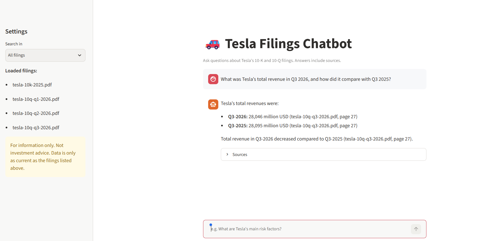
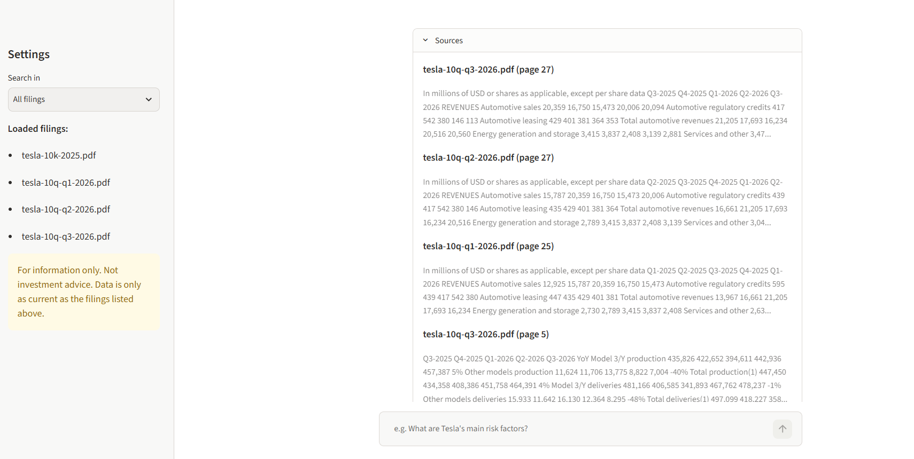

# 🚗 Tesla Filings Chatbot (RAG)

Ask questions about Tesla's official financial reports and get answers with file and page-level citations. If the answer is not in the documents, the bot says so instead of guessing.

**🔗 Live demo:** https://tesla-filings-rag-chatbot.streamlit.app/




## Features

- Answers questions using only the loaded Tesla documents
- Shows the source file and page for every answer, with the matching text
- Filter to search one document or all of them
- Refuses out-of-scope questions (for example stock price predictions or other companies)
- No investment advice or predictions

## Example questions

- What was Tesla's total revenue in Q3 2026, and how did it compare with Q3 2025?
- What were total vehicle deliveries in Q3 2026?
- What was free cash flow in Q3 2026?
- What does Tesla say about competition?

## How it works

1. **Ingest:** PDFs are read page by page and split into overlapping text chunks (`ingest.py`)
2. **Embed:** each chunk is converted into a vector with the Gemini embedding model
3. **Store:** vectors, text and page numbers are saved in ChromaDB
4. **Retrieve:** a question is embedded and the 6 most similar chunks are found
5. **Generate:** Gemini answers using only those chunks and cites file and page

The RAG pipeline is written from scratch in plain Python, without LangChain or LlamaIndex.

## Tech stack

Python · Streamlit · ChromaDB · Google Gemini API · pypdf

## Project structure

```
app.py            Streamlit chat interface
common.py         Shared helpers (API client, embeddings, model selection)
ingest.py         Builds the vector database from the PDFs
run_tests.py      Runs the 15 evaluation questions
data/             Tesla financial report PDFs
chroma_db/        Vector database
screenshots/      App screenshots
TESTING.md        Test questions, answers and results
test_results.md   Raw output of the last test run
```

## Run locally

```
git clone https://github.com/AnjaliAwati/tesla-finance-chatbot.git
cd tesla-finance-chatbot
python -m venv venv
venv\Scripts\activate        # Mac/Linux: source venv/bin/activate
pip install -r requirements.txt
```

Create a `.env` file in the main folder with your free Gemini API key (from aistudio.google.com):

```
GEMINI_API_KEY=your_key_here
```

Then build the database and start the app:

```
python ingest.py
streamlit run app.py
```

## Testing

Evaluated on 15 manually verified questions (`run_tests.py`, answers checked against the source PDFs):

| Retrieved chunks  | Correct        |
| ----------------- | -------------- |
| 4                 | 13 / 15 (87%)  |
| 6 (final setting) | 15 / 15 (100%) |

Increasing retrieval from 4 to 6 chunks fixed two questions where chart pages outranked the table with the answer. Details are in [TESTING.md](TESTING.md).

## Limitations

- Small test set (15 questions), mostly number lookups
- Answers are only as current as the loaded documents
- Numbers inside complex tables or charts may be extracted imperfectly from PDFs
- Each question is answered independently, so follow-up questions need full context
- Uses the Gemini free tier, so answers may be temporarily unavailable if the daily quota is used up
- Not investment advice

## Author

Anjali Awati · [LinkedIn](https://linkedin.com/in/anjali-awati-854491259) · [GitHub](https://github.com/AnjaliAwati)
